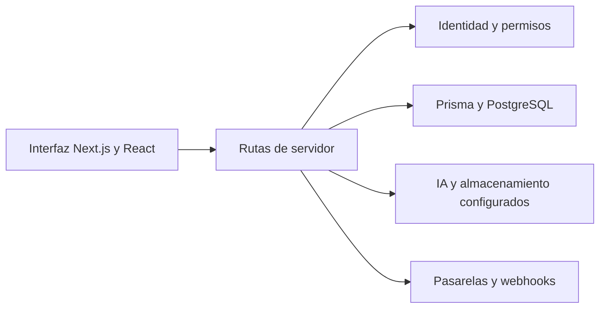

# Triarvon — plataforma web de desarrollo personal

[](https://github.com/Pablo-Cubides/Spartan_webpage/actions/workflows/ci-cd.yml)

[Sitio del proyecto](https://www.triarvon.com) · [Documentación](docs/README.md) · [Decisiones técnicas](docs/adr/)

Triarvon es el producto que evolucionó desde Spartan Club; el repositorio conserva el nombre histórico `Spartan_webpage`. Reúne contenido editorial, herramientas de estilo y coaching, cuentas de usuario y flujos de créditos/pagos en una aplicación Next.js.

## Qué explorar

| Recorrido | Qué muestra | Implementación |
|---|---|---|
| Navegar contenido y herramientas | Interfaz, contenido, metadatos y navegación de producto | [Aplicación](frontend/src/app/) |
| Analizar una imagen de estilo | Carga, validación, integración con IA y tratamiento de respuestas | [Asesor de estilo](frontend/src/lib/asesor-estilo/) |
| Gestionar una cuenta y créditos | Separación entre identidad, permisos y datos de aplicación | [Rutas de usuario y autenticación](frontend/src/app/api/) |
| Inspeccionar un pago | Recepción y validación de webhooks, persistencia y controles del flujo | [Pagos](frontend/src/app/api/payments/) y [pruebas](frontend/tests/payments/) |

Los análisis con IA, la autenticación y los pagos reales requieren configuración y credenciales propias. La navegación pública no implica que todas las integraciones estén habilitadas para una cuenta de demostración.

## Arquitectura y stack



El código de la aplicación vive en `frontend`. El stack incluye Next.js 15, React 19, TypeScript, Prisma/PostgreSQL, Firebase, Tailwind y servicios de IA, almacenamiento y pagos según el flujo. Consulta `frontend/package.json` y su lockfile para las versiones exactas.

Las especificaciones, contratos y decisiones de arquitectura acompañan los endpoints y cambios de datos. El workflow público ofrece feedback rápido; los controles de publicación más amplios se describen en los runbooks.

## Desarrollo local

Requiere Node.js 24.

```sh
git clone https://github.com/Pablo-Cubides/Spartan_webpage.git
cd Spartan_webpage/frontend
npm ci
npm run dev
```

Para usar webpack en desarrollo, por ejemplo si el procesamiento CSS de Turbopack falla con la configuración actual:

```sh
npx next dev --hostname 127.0.0.1 --port 3000
```

Revisa los ejemplos de variables de entorno sin subir valores reales. La generación de Prisma necesita descargar sus motores y las funciones de datos requieren una base de desarrollo. No reutilices cuentas, sesiones ni bases de producción para preparar pruebas.

## Validación

Desde `frontend`:

```sh
npm run type-check
npm test
npm run prisma:validate
npm run build
```

Desde la raíz:

```sh
npm run qa:prepush
```

Algunas pruebas necesitan `DATABASE_URL` y pueden omitirse sin ella; una ejecución con pruebas omitidas no valida esos flujos. El badge de CI representa su workflow concreto y no garantiza por sí solo todos los escenarios de negocio.

## Contexto del portafolio

El proyecto permite revisar un producto con interfaz, servidor, identidad, datos e integraciones comerciales. Las herramientas de estilo y personal shopper se integraron aquí desde proyectos independientes. Para evaluar un recorrido completo, revisa su contrato, casos de prueba y configuración necesaria, además de la pantalla inicial.

## Documentación

- [Índice de documentación](docs/README.md)
- [Configuración local](docs/runbooks/local-dev-setup.md)
- [Arquitectura y decisiones](docs/adr/)
- [Especificaciones y contratos](docs/specs/README.md)
- [Contribuciones](docs/CONTRIBUTING_SSD.md)

Proyecto personal; todos los derechos reservados. La disponibilidad pública del código no concede una licencia de código abierto.
